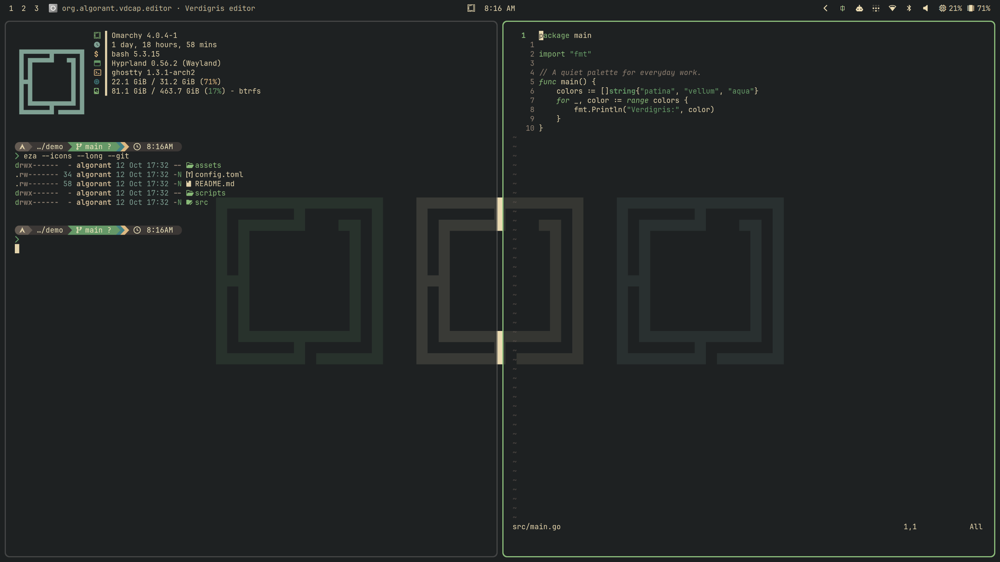
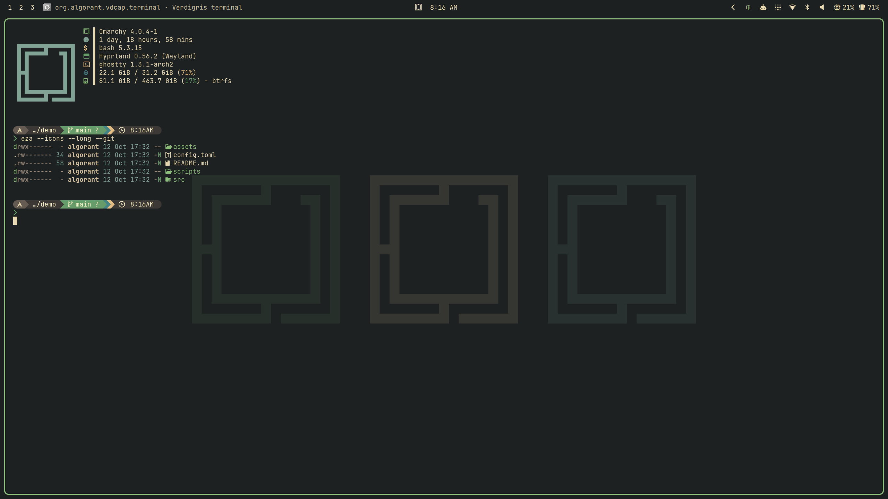
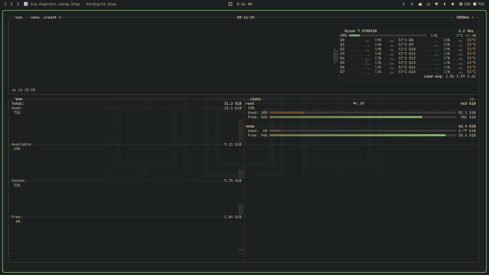
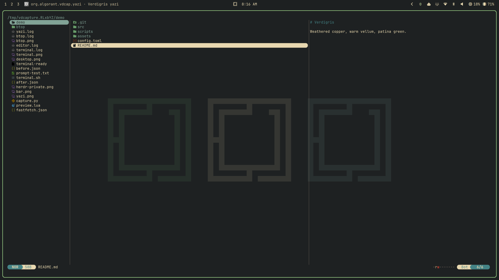
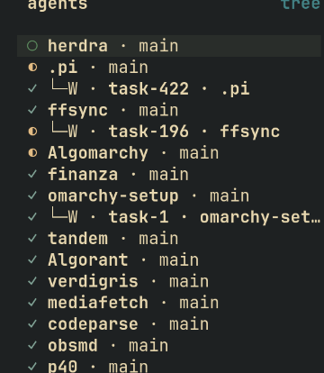

# Verdigris for Omarchy


[Verdigris](https://github.com/Algorant/verdigris) is a small oxidized-copper palette: weathered bronze, warm vellum, patina greens, cool aqua, brass ochre. This repository is its [Omarchy](https://omarchy.org/) theme.

## Previews

Desktop and app previews in Verdigris.

**Desktop**



**Terminal**



**btop**



**Yazi**



**Herdr**



## Install

```sh
omarchy theme install https://github.com/Algorant/omarchy-verdigris-theme
```

While this repository is private, anonymous HTTPS installs fail. Collaborators can authenticate over HTTPS with a credential helper or use the SSH URL `git@github.com:Algorant/omarchy-verdigris-theme.git`. The theme installs and appears as `verdigris`. `omarchy theme update` pulls new versions, and `omarchy theme remove verdigris` uninstalls it.

The theme uses `colors.toml` and `backgrounds/`, with documentation and preview images alongside. It has no terminal configs, `.lua` files or `vscode.json`, which Omarchy refuses from themes installed from git, so it installs with no dropped files.

## What gets themed

**By Omarchy, from `colors.toml`:** when the theme is set, Omarchy generates its standard theme files from the palette. That covers Hyprland borders, the Omarchy shell and bar, the Alacritty, Ghostty, Kitty and Foot terminals, btop, gum, Chromium, Helix, VS Code, Obsidian, Pi, Claude Code, T3 Code, Hermes, keyboard RGB and an Omarchy-default Neovim colorscheme.

**Added by this theme, beyond that colour inheritance:**

- **Wallpapers:** the default is triptych 1, a 5120×2880 pixel-exact triptych of the Omarchy mark in canonical palette colours on the theme base `#1d2021`. The alternates are triptych 2 and 26 wallpapers recoloured to Verdigris (`01-…` to `30-…`, each 4K or smaller, tagged `cool` or `vivid`). `omarchy theme bg next` (`Super+B`) cycles through them in filename order.

  | File | Left · centre · right |
  | --- | --- |
  | `00-verdigris-triptych-1-patina-vellum-aqua.png` | patina `#689d6a` · vellum `#ebdbb2` · aqua `#83a598` |
  | `00-verdigris-triptych-2-moss-vellum-aqua.png` | moss `#70764a` · vellum `#ebdbb2` · aqua `#83a598` |

- **A hand-mapped palette:** each Omarchy slot is chosen from the Verdigris palette rather than generated (see [Palette mapping](#palette-mapping)).

**Dedicated Verdigris ports, installed separately:** Omarchy doesn't theme these apps, or themes them only generically. Their ports live in the [Verdigris repository](https://github.com/Algorant/verdigris#readme): Neovim ([verdigris.nvim](https://github.com/Algorant/verdigris.nvim), replacing Omarchy's generated fallback), Starship, lsd, Atuin, bat, Yazi, ncspot, Herdr, and dedicated Pi, Claude Code, btop, Ghostty and Obsidian themes. Where you install a dedicated port, pick one owner per app so it doesn't fight Omarchy's generated file. For example, Ghostty's Omarchy `config-file` loads the generated palette.

## OLED panels

On OLED panels vellum can read too cool. There, set `foreground` and `bright_foreground` in `~/.config/omarchy/themes/verdigris/colors.toml` to the warmer cream `#f2d6a2`. Keep the change as a local commit so updates replay it:

```sh
cd ~/.config/omarchy/themes/verdigris
git config pull.rebase true
git commit -am "Local: foreground #f2d6a2 for OLED"
omarchy theme set verdigris
```

`omarchy theme update` then rebases the local commit onto new versions.

## Palette mapping

Colours come from the canonical Verdigris palette ([`css/palette.json`](https://github.com/Algorant/verdigris/blob/main/css/palette.json), version 0.1.2).

| Omarchy role | Verdigris source / choice | Reason |
| --- | --- | --- |
| Background | `#1d2021` | Dark reading surface shared with the Ghostty, Pi and btop ports; ashbronze is too bright for a full-screen dark UI. |
| Foreground | vellum `#ebdbb2` (OLED: warm cream `#f2d6a2`) | Canonical text colour, matching the other ports. |
| Accent | fern `#8ec07c` | Bright primary highlight, matching the Pi port. |
| Selection / brown | ashbronze `#665c54` | Weathered-metal accent and selection background. |
| Green / bright green | patina `#689d6a` / fern `#8ec07c` | Quiet versus bright green. |
| Blue / bright blue | teal `#458588` / aqua `#83a598` | Secondary versus brighter cool accent. |
| Yellow / orange | ochre `#e6bf86` / deep-copper `#b9805f` | Brass and copper roles. |
| Magenta | ink-violet `#8989b0` | Rare special/ANSI accent. |
| Red | `#fb4934` | The Ghostty port's readable red; canonical oxblood `#74363d` is too dark for error text on the base background. |

Muted text `#928374`, soft light text `#d4be9a` and the derived dark surfaces follow the existing Verdigris app ports.

## Wallpaper notes

The mark is redrawn from its 15×15 cell grid at an integer cell size, with no anti-aliasing or scaling blur. Omarchy sorts a theme's backgrounds by path. Setting the theme from another theme picks the first, so the `00-` prefix makes triptych 1 the default; re-setting Verdigris while it's already active advances to the next wallpaper instead. Before 2026-10-02 the theme used a quiet gradient wallpaper (`verdigris.png`, still in this repository's history).

## History

This theme was carved out of `omarchy/` in the Verdigris repository on 2026-10-12, with its history kept.
