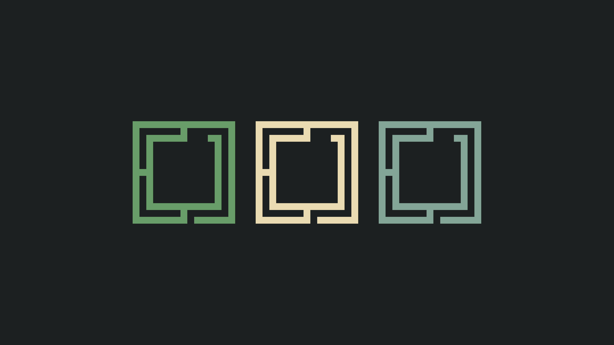

# Verdigris for Omarchy



[Verdigris](https://github.com/Algorant/verdigris) is a small oxidized-copper palette: weathered bronze, warm vellum, patina greens, cool aqua, brass ochre. This repository is its [Omarchy](https://omarchy.org/) theme.

## Install

```sh
omarchy theme install https://github.com/Algorant/omarchy-verdigris-theme
```

While this repository is private, install with the SSH URL `git@github.com:Algorant/omarchy-verdigris-theme.git` instead: an HTTPS clone can't authenticate. The theme installs and appears as `verdigris`. `omarchy theme update` pulls new versions, and `omarchy theme remove verdigris` uninstalls it.

The theme ships only `colors.toml` and `backgrounds/`. It has no terminal configs, `.lua` files or `vscode.json`, which Omarchy refuses from themes installed from git, so it installs with no dropped files.

## What gets themed

**By Omarchy, from `colors.toml`:** when the theme is set, Omarchy generates its standard theme files from the palette. That covers Hyprland borders, the Omarchy shell and bar, the Alacritty, Ghostty, Kitty and Foot terminals, btop, gum, Chromium, Helix, VS Code, Obsidian, Pi, Claude Code, T3 Code, Hermes, keyboard RGB and an Omarchy-default Neovim colorscheme.

**Added by this theme, beyond that colour inheritance:**

- **Wallpapers:** two 5120×2880 pixel-exact triptychs of the Omarchy mark, in canonical palette colours on the theme base `#1d2021`. Triptych 1 is the default; `omarchy theme bg next` cycles to triptych 2.

  | File | Left · centre · right |
  | --- | --- |
  | `verdigris-triptych-1-patina-vellum-aqua.png` | patina `#689d6a` · vellum `#ebdbb2` · aqua `#83a598` |
  | `verdigris-triptych-2-moss-vellum-aqua.png` | moss `#70764a` · vellum `#ebdbb2` · aqua `#83a598` |

- **A hand-mapped palette:** each Omarchy slot is chosen from the Verdigris palette rather than generated (see [Palette mapping](#palette-mapping)).

**Dedicated Verdigris ports, installed separately:** Omarchy doesn't theme these apps, or themes them only generically. Their ports live in the [Verdigris repository](https://github.com/Algorant/verdigris#readme): Neovim ([verdigris.nvim](https://github.com/Algorant/verdigris.nvim), replacing Omarchy's generated fallback), Starship, lsd, Atuin, bat, Yazi, ncspot, Herdr, and dedicated Pi, Claude Code, btop, Ghostty and Obsidian themes. Where you install a dedicated port, pick one owner per app so it doesn't fight Omarchy's generated file. For example, Ghostty's Omarchy `config-file` loads the generated palette.

## OLED panels

On OLED panels vellum can read too cool. There, set `foreground` and `bright_foreground` in `~/.config/omarchy/themes/verdigris/colors.toml` to the warmer cream `#f2d6a2`, then run `omarchy theme set verdigris`. This local edit leaves the clone dirty, so `omarchy theme update` may refuse to pull until you `git -C ~/.config/omarchy/themes/verdigris stash` it first.

## Palette mapping

Colours come from the canonical Verdigris palette ([`css/palette.json`](https://github.com/Algorant/verdigris/blob/main/css/palette.json), version 0.1.2).

| Omarchy role | Verdigris source / choice | Reason |
| --- | --- | --- |
| Background | `#1d2021` | Dark reading surface shared with the Ghostty, Pi and btop ports; ashbronze is too bright for a full-screen dark UI. |
| Foreground | vellum `#ebdbb2` (OLED: warm cream `#f2d6a2`) | Canonical text colour, matching the other ports. |
| Accent | fern `#8ec07c` | Bright primary highlight, matching the Pi port. |
| Selection / brown | ashbronze `#665c54` | Weathered-metal accent and selection background. |
| Green / bright green | patina `#689d6a` / fern `#8ec07c` | Quiet versus bright green. |
| Blue / bright blue | teal `#458588` / aqua `#83a598` | Secondary versus brighter cool accent. |
| Yellow / orange | ochre `#e6bf86` / deep-copper `#b9805f` | Brass and copper roles. |
| Magenta | ink-violet `#8989b0` | Rare special/ANSI accent. |
| Red | `#fb4934` | The Ghostty port's readable red; canonical oxblood `#74363d` is too dark for error text on the base background. |

Muted text `#928374`, soft light text `#d4be9a` and the derived dark surfaces follow the existing Verdigris app ports.

## Wallpaper notes

The mark is redrawn from its 15×15 cell grid at an integer cell size, with no anti-aliasing or scaling blur. Omarchy sorts a theme's backgrounds by filename, so the numeric prefix sets the default. Before 2026-10-02 the theme used a quiet gradient wallpaper (`verdigris.png`, still in this repository's history).

## History

This theme was carved out of `omarchy/` in the Verdigris repository on 2026-10-12, with its history kept.
